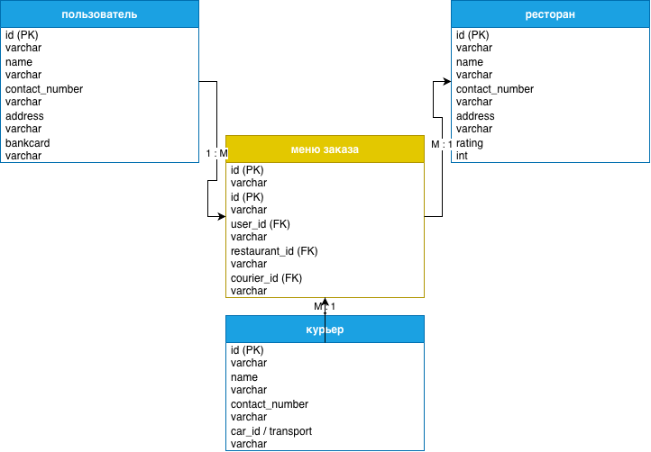

# computer-science-lab3
Лаба 3

# Анализ и моделирование данных предметной области

## 1. Описание предметной области

Сервис доставки еды.

Предметная область: заказ и доставка еды. Основные процессы: работа с ресторанами и меню, формирование заказа, оплата, назначение доставки и отслеживание статуса заказа.

Основные процессы:

- работа с ресторанами и меню
- приём заказов клиентов
- формирование заказа клиента (состав заказа)
- оплата заказа
- назначение доставки
- отслеживание статуса заказа

Пользователи системы:

- пользователи сервиса (клиенты)
- сотрудники доставки (курьеры)
- администраторы ресторанов

Основные задачи информационной системы:

- хранение информации о пользователях
- хранение информации о ресторанах и их меню
- хранение информации о заказах и их составе
- хранение информации об оплатах
- хранение отзывов пользователей
- хранение информации о сотрудниках (курьерах)
- отслеживание статуса заказа

## 2. Объекты данных

Пользователь — клиент, который заказывает еду из сервиса.
Необходимо хранить: имя, номер телефона, адрес доставки, данные карты (по разрешению пользователя).

Ресторан — место, откуда заказывается еда.
Необходимо хранить: название, адрес, контакты, рейтинг.

Блюдо — позиция меню ресторана.
Необходимо хранить: название, описание, цену, категорию, принадлежность к ресторану.

Заказ — оформленный клиентом заказ еды.
Необходимо хранить: дату, статус, сумму, ссылки на пользователя, ресторан и курьера.

Позиция заказа  — конкретное блюдо в заказе с количеством.
Необходимо хранить: ссылку на заказ, ссылку на блюдо, количество, цену на момент заказа.

Оплата — платёж по заказу.
Необходимо хранить: способ оплаты, сумму, дату, статус платежа, ссылку на заказ.

Курьер — человек, который отвозит еду.
Необходимо хранить: имя, контактный номер, данные о транспорте (скутер/машина).

Отзыв — оценка пользователем ресторана или курьера.
Необходимо хранить: текст, оценку, автора, ссылку на заказ.

## 3. Атрибуты объектов

### Пользователь

| Атрибут | Тип данных | Описание |
|---|---|---|
| id | число | уникальный идентификатор |
| имя | строка | имя пользователя |
| телефон | строка | контактные данные |
| адрес | строка | место доставки |
| карта | строка | данные карты (маскированные) |

### Ресторан

| Атрибут | Тип данных | Описание |
|---|---|---|
| id | число | уникальный идентификатор |
| название | строка | название ресторана |
| адрес | строка | место работы ресторана |
| телефон | строка | контактные данные |
| рейтинг | число | оценка обслуживания |

### Блюдо (меню)

| Атрибут | Тип данных | Описание |
|---|---|---|
| id | число | уникальный идентификатор |
| id_ресторана | число | ссылка на ресторан |
| название | строка | название блюда |
| описание | строка | состав/описание |
| цена | число | стоимость блюда |
| категория | строка | категория меню |

### Заказ

| Атрибут | Тип данных | Описание |
|---|---|---|
| id | число | уникальный идентификатор |
| id_пользователя | число | кто заказал |
| id_ресторана | число | откуда заказ |
| id_курьера | число | кто доставляет |
| дата | дата/время | дата оформления |
| статус | строка | статус заказа |
| сумма | число | итоговая стоимость |

### Позиция заказа (состав)

| Атрибут | Тип данных | Описание |
|---|---|---|
| id | число | уникальный идентификатор |
| id_заказа | число | ссылка на заказ |
| id_блюда | число | ссылка на блюдо |
| количество | число | сколько единиц |
| цена | число | цена на момент заказа |

### Оплата

| Атрибут | Тип данных | Описание |
|---|---|---|
| id | число | уникальный идентификатор |
| id_заказа | число | ссылка на заказ |
| способ | строка | карта / наличные / онлайн |
| сумма | число | сумма платежа |
| дата | дата/время | дата оплаты |
| статус | строка | успешно / отклонено / в обработке |

### Курьер

| Атрибут | Тип данных | Описание |
|---|---|---|
| id | число | уникальный идентификатор |
| имя | строка | имя курьера |
| телефон | строка | контактные данные |
| транспорт | строка | скутер / машина / велосипед |

### Отзыв

| Атрибут | Тип данных | Описание |
|---|---|---|
| id | число | уникальный идентификатор |
| id_пользователя | число | автор отзыва |
| id_заказа | число | по какому заказу |
| оценка | число | оценка (1–5) |
| текст | строка | текст отзыва |

## 4. Классификация данных

| Категория | Примеры | Назначение |
|---|---|---|
| Текстовые | имя, адрес, название, описание, статус | хранение текстовой информации об объектах |
| Числовые | id, телефон, цена, сумма, количество, рейтинг, оценка | хранение числовых значений |
| Логические | флаг «карта разрешена» | хранение признаков да/нет |
| Дата/время | дата заказа, дата оплаты | фиксация моментов времени |
| Вычисляемые | сумма заказа, итог по позициям | стоимость услуги |

## 5. Связи между объектами

| Связь | Тип | Реализация |
|---|---|---|
| Пользователь → Заказ | один ко многим | `Заказ.id_пользователя → Пользователь.id` |
| Ресторан → Заказ | один ко многим | `Заказ.id_ресторана → Ресторан.id` |
| Курьер → Заказ | один ко многим | `Заказ.id_курьера → Курьер.id` |
| Ресторан → Блюдо | один ко многим | `Блюдо.id_ресторана → Ресторан.id` |
| Заказ → Позиция заказа | один ко многим | `Позиция_заказа.id_заказа → Заказ.id` |
| Блюдо → Позиция заказа | один ко многим | `Позиция_заказа.id_блюда → Блюдо.id` |
| Заказ → Оплата | один к одному (или один ко многим) | `Оплата.id_заказа → Заказ.id` |
| Пользователь → Отзыв | один ко многим | `Отзыв.id_пользователя → Пользователь.id` |
| Заказ → Отзыв | один к одному | `Отзыв.id_заказа → Заказ.id` |

Связь «пользователь — ресторан» реализуется **не напрямую**, а через заказ: пользователь делает заказ в ресторане. Аналогично «ресторан — курьер» реализуется через заказ (курьер назначается на заказ).

## 6. Концептуальная модель данных

## 7. Оценка качества исходных данных

Достаточно ли объектов выделено?

Да. Выделены все ключевые сущности: пользователь, ресторан, блюдо (меню), заказ, позиция заказа, оплата, курьер, отзыв. Это покрывает основные процессы предметной области.

Отсутствуют ли важные сущности?

Нет надеюсь

Все ли необходимые атрибуты определены?

Для концептуальной модели определены основные атрибуты каждого объекта, включая первичные и внешние ключи. При реализации реальной системы набор атрибутов может быть расширен.

Имеются ли дублирующиеся данные?

Явного дублирования нет. Информация о пользователях, ресторанах, блюдах, заказах, оплатах и курьерах хранится в отдельных объектах и связывается через внешние ключи. Цена блюда в позиции заказа дублируется намеренно — для фиксации цены на момент оформления.

Достаточно ли информации для дальнейшего проектирования информационной системы?

Да наверно

## Вывод

В ходе лабораторной работы была проанализирована предметная область заказа и доставки еды. Выделены основные объекты данных (пользователь, ресторан, блюдо, заказ, позиция заказа, оплата, курьер, отзыв), определены их атрибуты, первичные и внешние ключи, выполнена классификация данных.

Между объектами определены связи «один ко многим», «один к одному» и «многие ко многим» (реализуемая через промежуточные сущности). На основе анализа построена концептуальная модель данных.

Полученная модель описывает основные данные сервиса заказа и доставки еды и может использоваться как основа для дальнейшего проектирования информационной системы.